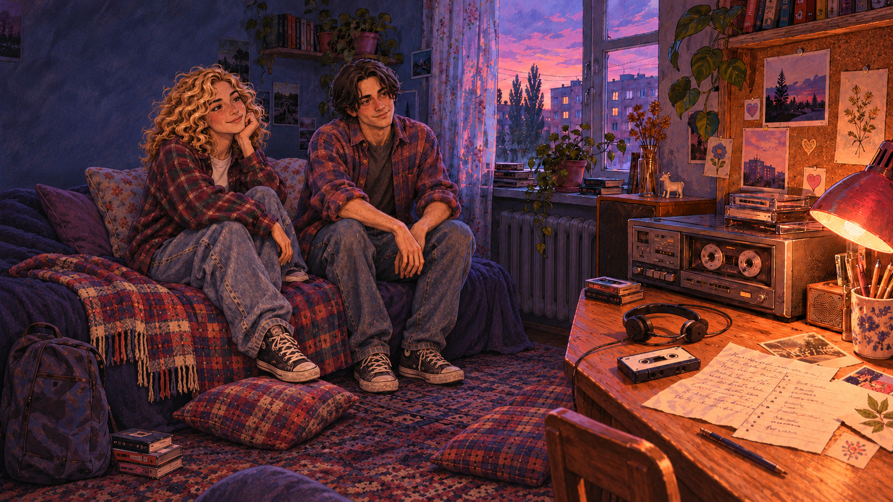

# I still remember your sound

Українська мальована вебновела про родину, музику та пам’ять. Студентський проєкт курсу «Технології мультимедіа».

**Авторка: Марія Колесник · КН-3.**

[Грати на GitHub Pages](https://maryxseee.github.io/i-still-remember-your-sound/) · [Додаткова хмарна адреса](https://i-still-remember-your-sound.dustycricket.chatgpt.site)

Сайт працює в хмарі: ноутбук авторки можна вимикати. Встановлення й вхід в акаунт не потрібні.



## Версія 1.2 — три вечори, вісім продовжень

Стара коробка із шафи відкриває спогади бабусі Лідії (1978), мами Меліси (1996) та старшої сестри Софії (2004). Героїня бачить себе на їхньому місці, у вбранні відповідної епохи. Знайомство й кохання, прощання друзів та перше покликання до роботи зі звуком — три окремі історії.

Оглядай предмети за бажанням, зіставляй свідчення й вирішуй, що робити. Підказки відкриваються поступово за запитом. Невеликі помилки можна виправити; пошкодження платівки, перезапис касети та вибір архівного диска вимагають окремого підтвердження. Після кожного епізоду видно справжній результат, уявну сцену відсутності з іншим тлом і тишею та повернення до реального спогаду.

Доля трьох записів автоматично визначає одну з восьми кінцівок. Кожна має власну історію й ілюстрацію. Інтернет повертається в усіх фіналах. Можна додати назву своєї пісні й особистий спогад до завершення: це текстова частина історії, без пошуку чи відтворення введеної композиції. Усі три фотокартки зберігаються незалежно від стану аудіозаписів.

## Звук і керування

MP3 Golden Hour, Reverie та Childhood by Scott Buckley (CC BY 4.0) включені до сайту. Перше натискання «Почати історію» запускає музику; далі вона супроводжує діалоги та завдання, плавно змінюється й стихає в уявних сценах відсутності. Якщо браузер блокує звук, з’являється кнопка відновлення. Авторство й джерела — у титрах і [soundtrack.md](docs/soundtrack.md).

Миша, дотик або клавіатура. Tab / Shift+Tab — вибір елемента; Enter / Space — дія або наступна репліка; Escape — закриття вікна. Касетні фрагменти переміщуються стрілками. Головоломки доступні без звуку. У налаштуваннях є більший текст, гучність, вимкнення звуку й зменшення руху.

Прогрес автоматично зберігається в поточному браузері. Імпорт і експорт доступні в налаштуваннях. Збереження старої короткої версії залишаються окремо: нова розширена історія починається заново. Відкриті кінцівки нової версії не зникають після нового проходження.

## Локальний запуск і перевірки

Потрібен Node.js 22+. Залежностей для встановлення немає.

```text
npm start
npm test
npm run build:web
```

Локально: http://127.0.0.1:4173. Хостинг публікує `dist/`. Сценарій і ресурси також можна відкрити через `index.html` із повністю розпакованої папки.

37 автоматичних перевірок охоплюють усі вісім комбінацій, незворотні дії, повторні спроби, сумісність CD, збереження, межі діалогів, текстовий фінал, наявність ілюстрацій та відтворення MP3. Додатково перевірені повні браузерні маршрути 111 і 000 та мобільний екран 390 × 844.

Документація: [новий сценарій і гілки](docs/novel-story.md), [нові ілюстрації та промпти](docs/novel-art-prompts.md), [джерела музики](docs/soundtrack.md), [план реалізації](docs/superpowers/plans/2026-11-12-complete-novel.md). Початковий поданий сценарій DOCX не змінювався.

Виправлення 1.1: захист від пропусків реплік, CSS у документі для надійнішого мобільного завантаження, позиція Марка, приховані родинні зв’язки до епілогу, окремі сімейні портрети та нові сцени можливого життя без музики. Авторка: Марія Колесник · КН-3. [Подробиці](docs/revisions-1.1.md).

## Огляд предметів

«Оглянути коробку» або «Оглянути стіл» відкриває окремий мальований крупний план. Натискай позначки на предметах або їхні назви під зображенням. Записка, книжечка, лист і концертний блокнот мають власне оформлення з темним текстом. Повернення до огляду не скидає завдання. Фотокартки відповідають складу учасників: троє / двоє / двоє. Знаки питання використовуються тільки у вступних розмовах; далі герої мають власні портрети.

## Структура проєкту

- `src/engine.js` — переходи, результати, збереження та вибір кінцівки.
- `src/story.js` — діалоги, знахідки, підказки й вісім фіналів.
- `src/inspection.js` — зображення огляду, ділянки предметів і паперові основи.
- `src/app.js` — інтерфейс; `visual.js`, `audio.js`, `music.js` — персонажі, анімація й звук.
- `assets/` — усі зображення та MP3; `docs/` — сценарій, джерела й промпти.
- `tests/` — перевірки; `tools/` — локальний сервер і статична збірка.

## Публікація

GitHub Actions перевіряє гру й збирає `dist/`. Після оновлення `main` збірка автоматично публікується на GitHub Pages. Гілка `feat/interactive-story` зберігає робочу історію розвитку. Докладніше: [хостинг](docs/hosting.md), [зміни](CHANGELOG.md), [ілюстрації огляду](docs/inspection-art-prompts.md).
